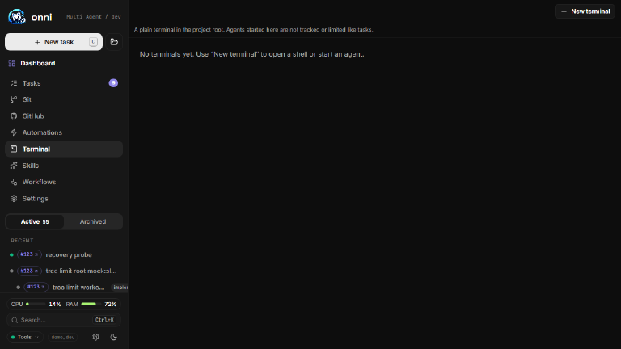
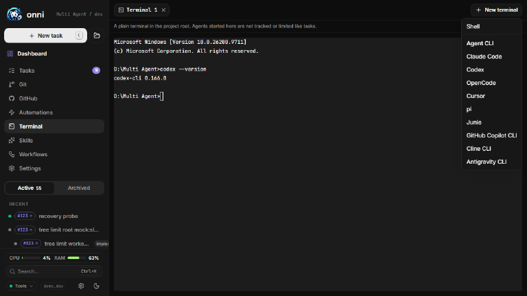
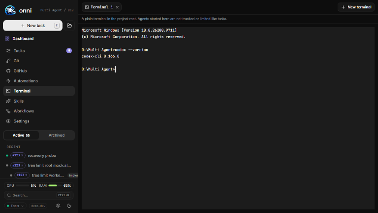
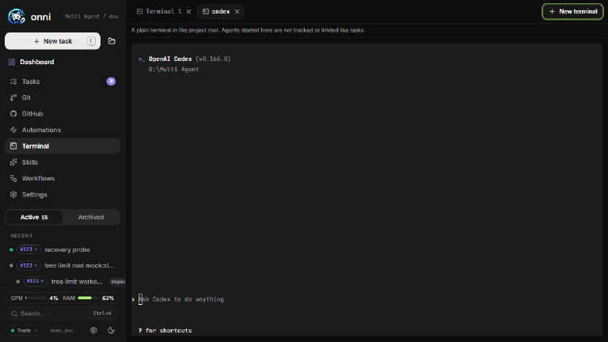

# Terminal tabs để chạy agent CLI (thiết kế)

Trạng thái: **đã làm bản đơn giản** (2026-11-02). Phần "worktree của task" ở §3.2/§4 đã bị cắt theo quyết định của chủ dự án: thư mục luôn là gốc project, không có `cwd` trong contract.

## 1. Mục tiêu

Một khu riêng trong cockpit, **không gắn với task nào**, cho người dùng mở nhiều tab terminal và chạy
thẳng các agent CLI (`claude`, `codex`, `opencode`, `cline`, `agy`, …) bằng tay, tương tác đầy đủ như
ngoài cmd/PowerShell, nhưng nằm trong cockpit và dùng đúng project đang chọn.

Khác với một task: không worktree, không `RunRecord`, không steps/diff/tokens. Đây là terminal thật,
không phải một lượt chạy được theo dõi.

## 2. Đã có sẵn, tái dùng (không viết lại)

Repo đã có terminal theo từng task (spec `2026-10-07-task-workspace.md` §6). Chỗ nào trùng thì dùng lại:

| Có sẵn | Ở đâu | Dùng cho |
| --- | --- | --- |
| PTY, scrollback 256 KB, tối đa 32 session | `packages/work/src/server/terminal/sessions.ts` | toàn bộ vòng đời shell |
| Owner key không phải runId: `projectTerminalOwner(projectId)` | cùng file | **session thuộc project, không thuộc task** |
| Binding PTY tùy chọn, báo "không khả dụng + lý do" | `pty-module.ts` | degrade êm trên máy thiếu binary |
| Allowlist shell, body không được chỉ định executable | `shells.ts`, `terminalCreateSchema.shell` | giữ nguyên nguyên tắc |
| Đọc output bằng cursor + replay + cờ `truncated` | `terminalOutputSchema` | reload trang vẫn nối lại tab |
| Cờ `busy` (shell còn tiến trình con) | `terminalSessionSchema.busy` | hỏi xác nhận trước khi đóng tab |
| Emulator + tab trong task view | `routes/task-workspace/terminal-drawer.tsx` | tách thành component dùng chung |
| Gate `ONNI_TERMINAL` (local bật, hosted tắt) | `capabilities.ts` | **không thêm biến mới** |

Vì vậy tính năng này chủ yếu là: (a) một route/trang mới, (b) cho phép tạo session với owner là project,
(c) bộ mở nhanh theo agent.

## 3. Quyết định thiết kế

1. **Không thêm biến `ONNI_*`.** Dùng lại `ONNI_TERMINAL`. Hosted vẫn tắt mặc định (AGENTS.md: thứ làm
   rộng bề mặt phải opt-in). Không cần cập nhật `.env.example`.
2. **Thư mục chạy chỉ có hai lựa chọn có kiểm soát:** gốc project (mặc định), hoặc worktree của một task
   có sẵn (`{ kind: 'worktree', runId }`). Không nhận đường dẫn tự do từ body.
3. **Agent lấy từ allowlist, không nhận lệnh thô.** Body chỉ gửi `agent: <backend id>`; server tự ánh xạ
   sang tên binary và chỉ cho agent mà `health.checks` báo đã cài. Cùng tinh thần với `shell`.
4. **Mở shell rồi gõ lệnh agent vào** (không spawn agent trực tiếp). Khi agent thoát, tab vẫn còn shell để
   người dùng chạy tiếp hoặc mở lại. Trên Windows dùng cú pháp PowerShell (`$env:...`), theo AGENTS.md.
5. **Môi trường tối thiểu như terminal task hiện tại.** Không đưa secrets của tracker; không đặt
   `ONNI_TASK_ID`, nên không vào Job Object của một run.
6. **Trung thực về phạm vi an toàn:** agent chạy trong tab này là chạy **bằng tài khoản của người dùng, không
   có `push-guard`, không có deny rules, không bị sweep giới hạn chi phí/thời gian**. Giao diện ghi rõ một
   dòng: "Không được theo dõi như task". Muốn có hàng rào thì dùng `/new`.
7. **Trạng thái trong RAM của engine.** Tab sống qua reload trang, mất khi engine khởi động lại. Không ghi
   file nào cần thiết (khớp "State is written, never required"). Thứ tự/tên tab của riêng từng người xem
   chỉ lưu `localStorage`, bọc try/catch.

## 4. Contract (`packages/contract/src/terminal.ts`)

Chỉ thêm trường **tùy chọn**, để client/server cũ vẫn parse được:

```ts
// terminalCreateSchema
agent: z.enum(RUNNER_IDS).optional(),            // mở nhanh một agent; vắng = shell trần
cwd: z.discriminatedUnion('kind', [
  z.object({ kind: z.literal('project') }),
  z.object({ kind: z.literal('worktree'), runId: z.string() }),
]).optional(),                                    // vắng = project

// terminalSessionSchema
agent: z.enum(RUNNER_IDS).optional(),            // để nhãn tab và biểu tượng đúng
```

- Nhãn tab: `agent` nếu có, ngược lại theo quy tắc hiện tại (lệnh đang chạy, hoặc `Terminal N`).
- Route đi qua family builder hiện có và `validators.ts`, không `safeParse` trong handler; chạy lại
  `contract-parity*.test.ts` và `route-parity.test.ts`.
- Đường dẫn route chính xác phải đối chiếu với `terminal-routes.ts` lúc code (spec này chưa khẳng định).

## 5. Giao diện

- Mục **Terminal** trong sidebar, route `/terminal`, nằm cạnh các view cấp project.
- Thanh tab: nút **+** mở menu "Shell trần" và từng agent. Agent chưa cài hiện mờ kèm lý do ("chưa cài").
  Thanh tab **cuộn ngang**, không xuống dòng, để không lặp lỗi lệch bố cục đã sửa ở Tài khoản agent.
- Tab hiện: biểu tượng agent, nhãn, chấm "đang chạy". Đóng tab khi `busy !== false` thì hỏi xác nhận.
- Đổi tên tab bằng nhấp đúp. Chưa làm split-pane ở phiên bản đầu.
- Khi `available: false`, hiện đúng `reason` từ server thay vì ẩn trang.
- Mọi chuỗi qua `t()` và thêm bản dịch vi (`lib/i18n`).
- Đổi emulator trong `terminal-drawer.tsx` thành component dùng chung; drawer của task và trang này cùng gọi.

## 6. Tín hiệu live

Dùng topic WebSocket của session như hiện nay (không `new WebSocket` mới). Hosted thì poll theo cursor.
Subscribe theo vòng đời tab, trả unsubscribe trong `useEffect`, chỉ publish khi có output mới.

## 7. Giai đoạn

1. **Server:** cho `create` nhận owner project + `cwd`/`agent`, ánh xạ allowlist agent, test trong
   `sessions.test.ts` và `terminal-routes.test.ts` (kể cả: agent chưa cài bị từ chối, `cwd` ngoài allowlist
   bị từ chối, vượt `MAX_SESSIONS`).
2. **Contract + client:** thêm trường tùy chọn, chạy parity tests.
3. **UI:** route `/terminal`, thanh tab, menu mở agent, tách emulator dùng chung, i18n, test cạnh code.
4. **Sau đó (không bắt buộc):** truyền sẵn mức suy luận khi mở agent, dựa trên bản probe
   `scripts/probe-agent-reasoning.mjs` (codex `-c model_reasoning_effort=`, agy `--effort`,
   cline `--thinking`, opencode `#variant`).

## 8. Rủi ro

- **Đây là shell trên máy chủ.** Trên cockpit hosted không có đăng nhập phía trước thì là RCE. Giữ
  `ONNI_TERMINAL` mặc định tắt ở hosted; không nới.
- **Windows:** `@lydell/node-pty` thiếu binary thì terminal báo không khả dụng, không được làm hỏng boot.
  Gõ lệnh agent vào PowerShell phải thoát ký tự đúng; test trên Windows trước.
- **Agent tương tác (TUI) cần phím đặc biệt và resize đúng.** Đã có `terminalResizeSchema`; cần test thủ
  công với ít nhất `codex` và `claude`.
- **Người dùng nhầm đây là task được bảo vệ.** Xử lý bằng dòng cảnh báo cố định (mục 3.6).
- **Dọn session mồ côi:** `closeAllTerminals()` khi tắt engine, và giới hạn `MAX_SESSIONS` dùng chung với
  terminal của task; cần quyết định có tách hạn mức riêng cho trang này không.

## 9. Đã chốt

1. Thư mục mặc định và duy nhất: gốc project. Không có lựa chọn worktree.
2. Mở agent bằng cách gõ lệnh vào shell (agent thoát thì tab còn prompt), không spawn trực tiếp.
3. Chạy nhiều tab, mỗi tab một agent khác nhau.

Còn để ngỏ: hạn mức session dùng chung `MAX_SESSIONS` (32) với terminal của task; mở terminal khi chưa chọn project.

## 10. Ảnh chụp bản đã làm

Chụp trên server dry-run, giao diện tiếng Anh, project `Multi Agent`.

| Ảnh | Nội dung |
| --- | --- |
|  | Trang mở trống, không tự tạo shell |
|  | Menu "New terminal": Shell và 9 agent CLI |
|  | Tab shell trong gốc project, chạy `codex --version` |
|  | Hai tab song song: `Terminal 1` và `codex` (Codex TUI) |
